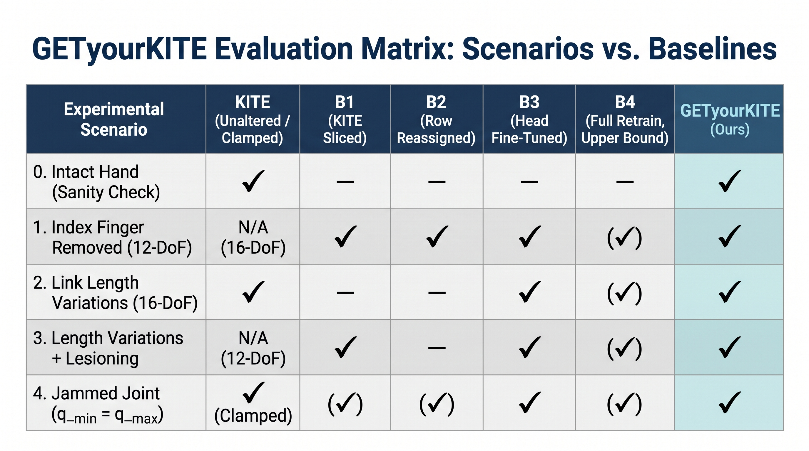

# GETyourKITE

CS 6758 (Deep Learning for Robotics, Cornell, Fall 2026) project by Janice Shen, Anushka Vijay, Aryan Patel and Simon Tebeck.

[KITE](https://kite-manip.github.io) (Wang et al., 2026) splits manipulation into a shared
policy that predicts a contact-based *latent intent* and a kinematic decoder per robot that
turns the intent into joint targets. A new hand, or a hand with a broken finger, needs its
own decoder. We replace KITE's per-hand decoder parameters with a graph-conditioned decoder
in the style of [GET-Zero](https://get-zero-paper.github.io) (Patel & Song, 2025): joints
become tokens described by the URDF, with attention biased by the kinematic tree. The aim
is that one set of weights drives unseen and lesioned variants of a hand zero-shot, with
KITE's intent encoder and policy kept frozen.

## Status

- **LEAP data:** the LEAP hand family ([get-ur-kite-dataset](third_party/get-ur-kite-dataset))
  is a submodule; `getkite.leap` turns it into decoder training batches, with KITE's frozen
  intent encoder ψ. Decoder training and results are described in [docs/decoder.md](docs/decoder.md).

- **Scoring:** CEBenchmark's staged scores run on KITE's rollouts; success is KITE's own
  success rule, so success rates match KITE's.
- **Viewer:** `scripts/demo_task.py` replays Objects Placing and Keyboard Pressing on
  Barrett, Allegro and Wuji with the score drawn live.
- **Open issue:** with KITE's own script and shipped configs we do not reproduce the
  paper's Oracle-Intent success on Objects Placing (ours: Barrett 67 %, Wuji 67 %,
  Allegro 17 %; paper: 82 / 85 / 85 %). See [docs/scoring.md](docs/scoring.md) for what has
  been ruled out.
- **Decoder:** GET joint tokens vs a shared-slot baseline on LEAP variants (preliminary, GET slightly
  ahead: 7.64 vs 7.80 mm on the full validation split), and a pilot of one scratch decoder across Allegro, Barrett and LEAP. See
  [docs/decoder.md](docs/decoder.md).
- **Mac evaluation:** CPU setup, four checked demo episodes, score reports and local video links
  are in [docs/MAC_EVALUATION.md](docs/MAC_EVALUATION.md).
- **Baseline plan:** [docs/GETZERO_BASELINE.md](docs/GETZERO_BASELINE.md) explains what we can
  reuse from GET-Zero and how to make a matched graph-on/off comparison.
- **Not in KITE's release:** trained interaction policies, the bottle meshes, the nut
  simulation, and an XHand decoder.

## Idea for the Experiments and Evaluation


## Layout

```
GETyourKITE/
├── src/getkite/
│   ├── scoring/          staged, embodiment-agnostic scores (ported from CEBenchmark)
│   ├── tasks/            one score spec per KITE task: objects_placing, keyboard_press, pump_bottle
│   ├── leap/             LEAP family: hand bank + batched FK, KITE's frozen ψ, training batches, MJCF export
│   ├── decoder/          the GET decoder: models, training, evaluation (docs/decoder.md)
│   ├── kite_bridge.py    finds the KITE checkout; ScoringSession scores KITE rollouts unchanged
│   └── viz.py            viewer and video displays with CEBenchmark's live score overlay
├── configs/decoder/      decoder run configs (paths are ${...} placeholders, no machine paths)
├── scripts/
│   ├── setup_env.sh      creates the getyourkite conda environment
│   ├── demo_task.py      watch KITE episodes with the score on screen (viewer or MP4)
│   ├── rollout_scored.py run any KITE rollout/eval script with scores attached
│   ├── make_leap_mjcf.py floating, actuated MJCF (KITE's format) for any LEAP hand of the dataset
│   └── decoder/          pilot config generator, result tables, one-off diagnostics
├── slurm/                cluster jobs for decoder training/evaluation and the run watchdog
├── assets/leap/          the nominal LEAP hand as a floating MJCF
├── tests/                unit tests (each skips when its data is missing); tests/decoder/ for the decoder
├── docs/
│   ├── scoring.md        what the scores measure, the paper comparison, what KITE's release contains
│   ├── decoder.md        decoder: layout, where data lives, how to run, results so far
│   └── training_plan.md  plan for the LEAP head and the GETyourKITE decoder
├── third_party/KITE                  KITE code (git submodule, helloqxwang/KITE)
├── third_party/get-ur-kite-dataset   LEAP hand family and training data (git submodule)
├── environment.yml, requirements.txt the getyourkite environment
```

Data generation changes go to [get-ur-kite-dataset](https://github.com/jaas-hands/get-ur-kite-dataset),
model work goes here. Large data, checkpoints and runs are never stored in this repo; the decoder finds them
through `KITE_ROOT`, `GETKITE_DATASET`, `GETKITE_DATA` and `GETKITE_RUNS` (see
[docs/decoder.md](docs/decoder.md#data-and-runs-live-outside-the-repo)). In the `getyourkite` environment
`GETKITE_DATASET` defaults to the submodule's `data/`.

## Setup

For CPU evaluation on Apple Silicon, see [Task evaluation on Mac](docs/MAC_EVALUATION.md).
The setup below is for the Linux/CUDA environment.

Needs Linux, an NVIDIA GPU, CUDA Toolkit 12.8 (`/usr/local/cuda-12.8`, or set `CUDA_HOME`) and conda.

```bash
git clone --recursive <this repo>        # or, in an existing clone: git submodule update --init
cd GETyourKITE
bash scripts/setup_env.sh --data         # the getyourkite env, KITE's assets and the LEAP dataset
conda activate getyourkite
export MUJOCO_GL=egl OMP_NUM_THREADS=1 OPENBLAS_NUM_THREADS=1
python -m pytest                         # 96 tests, ~20 s
```

One environment holds everything: KITE's exact pinned packages (`third_party/KITE/requirements.txt`,
torch 2.9.1+cu128, MuJoCo 3.8.0), pytorch3d built from KITE's copy, the dataset's extra
packages, and `getkite` and `kite_data` installed in editable mode. `setup_env.sh` takes about
4 minutes with a warm pip cache; `--data` adds KITE's asset download (~520 MB) and the dataset
build (~1 GB, a few minutes on 16 cores). Without `--data`, run those later:

```bash
(cd third_party/KITE && python download_assets.py)
(cd third_party/get-ur-kite-dataset && ./scripts/fetch_assets.sh && python -m kite_data.build_hands \
   && python -m kite_data.splits && python -m kite_data.generate)
```

The older `kite` environment from KITE's README still works for the scoring and viewer scripts.

## LEAP training data

[get-ur-kite-dataset](third_party/get-ur-kite-dataset) generates the LEAP hand family (243
finger layouts × 7 geometries, hand-level train / val / test splits) and examples with KITE's
decoder recipe. `getkite.leap` makes decoder batches from it, on the GPU:

```python
from getkite.leap.data import LeapSplit
from getkite.leap.intent import IntentEncoder

split = LeapSplit.load("train", device="cuda")          # 1M examples, ~1 GB
psi = IntentEncoder.load(device="cuda")                 # KITE's frozen intent encoder
for batch in split.batches(1024, psi=psi, normal_noise=0.1):
    batch["z"], batch["hand_points"], batch["joint_features"], batch["spd"], batch["joints_goal"]
```

The batch keys are listed in [src/getkite/leap/data.py](src/getkite/leap/data.py). Checked by
`tests/test_leap.py`: forward kinematics at the label reproduces the dataset's contacts (5e-8 m),
ψ reproduces the latents KITE stored for its own episodes (4e-5 relative error), and the
floating MJCF in [assets/leap](assets/leap/README.md) matches the kinematics.

## Watching a task

`scripts/demo_task.py` replays episodes of a KITE task on one hand, with the score drawn
live. The episodes are *Oracle Intent* runs: the latent intents encoded from the source
robot's demonstrations, executed through KITE's released decoder for the chosen hand, so no
policy has to be trained first (KITE's release has no trained policies).

| `--task` | Task | Demonstrated by | Episodes |
|---|---|---|---|
| `placing` (default) | Objects Placing: pick a YCB object, put it in the bin | Robotiq gripper | 100, six objects |
| `keyboard` | Keyboard Pressing: three keys down at once | Wuji hand | 20 |

Bottles Pumping and Nut Rotating cannot be run: KITE's release lacks the bottle meshes and
the nut simulation ([details](docs/scoring.md#what-kites-release-contains)).

```bash
conda activate kite                      # from the repo root
python scripts/demo_task.py --task keyboard --hand allegro --episodes 3   # keyboard pressing
python scripts/demo_task.py --hand barrett --object mug                  # objects placing, one mug episode
python scripts/demo_task.py --hand wuji --object sugar --episodes 3 --speed 0.5
python scripts/demo_task.py --hand allegro --episodes 6                  # one per object
python scripts/demo_task.py --hand barrett --indices 55,51               # exact episodes
```

A MuJoCo window opens and plays the episodes in sim time (`--speed 0.25` for slow motion).
Each episode takes about 6 s of sim time plus a few seconds to load.

| Where | What it shows |
|---|---|
| top right | the live score, the current stage's progress, the stage, success (KITE's own rule, with speed), sim time, when each stage was done, and quality |
| bottom right | the score over the episode: current (red) and peak (green); the episode's score is the peak |
| top left | hand, object (or task), episode index, control step, for Objects Placing whether the object was also **lowered into the bin**, the deepest a finger has sunk into the object, and contact flags (parts forced into each other, brute force) |

Keys: **Space** pauses, **Tab** / **Shift+Tab** show MuJoCo's side panels (or start with
`--panels`), drag with the mouse to move the camera, close the window to stop.

The terminal stays short: one line per episode as it ends, then the totals.

```
$ python scripts/demo_task.py --indices 55,20
Barrett (floating), Objects Placing, held-out episodes 55, 20 (viewer)
  Space pauses, Tab shows MuJoCo's panels, closing the window stops.
  episode  55  025_mug               success     score 100.0 %  stages done: lift, carry   lowered into bin
  episode  20  024_bowl              no success  score   4.9 %  stages done: -             not lowered into bin
2 episodes: mean score 52 %, success 1/2
KITE's output: outputs/demos/kite_log.txt
```

KITE's own output (config dumps, progress lines, driver messages) goes to
`outputs/demos/kite_log.txt`; `--verbose` prints it instead, with the full score table at
the end. If KITE stops with an error, the end of that log is printed.

**Videos instead of a window** (headless, e.g. on the cluster or for slides): add `--record`.
One MP4 per episode goes to `outputs/demos/`, drawn with the same overlay:

```bash
python scripts/demo_task.py --hand barrett --object mug --episodes 2 --record
python scripts/demo_task.py --hand wuji --indices 37 --record --video-speed 0.5 --video-size 1920x1080
```

Options: `--task {placing,keyboard}`, `--hand {barrett,allegro,wuji}`, `--object` (part of a name: pudding, bowl, meat,
mug, sugar, mustard), `--episodes N`, `--start K` (skip K matching episodes), `--indices`
(episode indices: placing 0–99, keyboard 0–19), `--speed`, `--panels`, `--record`, `--video-speed`, `--video-fps`,
`--video-size`, `--out`, `--verbose`. Anything after `--` is passed to KITE's rollout script as a Hydra
override. The script picks the OpenGL backend itself (GLFW on macOS and for the window, EGL for Linux videos);
on WSL the window needs WSLg (Windows 11), on a remote machine use `--record`.

Success is KITE's own success rule. Expect failed episodes: on this machine Oracle-Intent
success is below the paper's (Objects Placing: about 2/3 for Barrett and Wuji and 1/6 for
Allegro, against 82–85 % in the paper; Keyboard: Allegro 15/20, Wuji 14/20, Barrett 1/20
with our assembled config). The gap is an open issue, see [docs/scoring.md](docs/scoring.md).

**A short tour** of what the score adds over KITE's yes/no:

| Command | What to look for |
|---|---|
| `--hand barrett --indices 55` | a clean success: lift and carry are done in turn, the score reaches 100 %, and the mug is also lowered into the bin |
| `--hand barrett --indices 51` | the mug tips over: the score stays near 5 %, nothing lifts |
| `--hand wuji --indices 37` | a success by KITE's rule (the can is over the bin), but it is never lowered into it: "lowered into bin" stays "no" |
| `--hand allegro --indices 20` | Allegro lifts the bowl, then drops it: the score keeps the lift's credit (peak), no success |
| `--task keyboard --hand allegro --indices 0` | three fingers find the three keys: "keys", then "chord" |
| `--task keyboard --hand allegro --indices 1` | a near miss: the keys go partly down, score 40 %, no success |
| `--hand barrett --indices 90` vs `--hand allegro --indices 90` | the same intents on two hands; watch "finger depth max": Barrett's fingertips sink about 2 cm into the mustard bottle and it succeeds, Allegro's barely touch it and it fails |

## Scoring KITE rollouts

```bash
python scripts/rollout_scored.py --out outputs/scores/barrett.json -- \
    --config-name=rollout_gt_contacts/object_suite_barrett online_rollout.count=10
```

Prints one line per episode (success by KITE's rule, score, whether the object was lowered
into the bin, quality, max hand penetration, stages reached, contact flags) and saves them
as JSON. Everything after `--` goes
to the KITE script unchanged. See [docs/scoring.md](docs/scoring.md) for what the scores
mean, how CEBenchmark's scoring was adapted to KITE, and the first numbers.

## Provenance

- `third_party/KITE`: [helloqxwang/KITE](https://github.com/helloqxwang/KITE), used unmodified.
- `third_party/get-ur-kite-dataset`: the team's LEAP dataset repo, used unmodified.
- `assets/leap/`: generated from the dataset; collision geometry from MuJoCo Menagerie (MIT),
  see [assets/leap/README.md](assets/leap/README.md).
- `src/getkite/scoring/`: copied from CEBenchmark (`cebench/tasks/_base`, commit `ffad82e`),
  only the import paths changed. Keep the two in sync.

## Next steps

- Agree on the main decoder, held-out hands and comparison settings before running
  the full evaluation.
- Connect the selected checkpoint to the task runner and use the same episodes
  and starting states for every model.
- Keep contact results, task scores and rollout videos together, with the success
  definition stated for each experiment.
